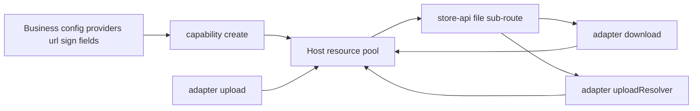

# store-resource-bootstrap

**A small assembly plugin that gives a common-store host its resource capability — providers, URL and signing policy, schema registration, column mapping — and hands store-api the three resolvers its file sub-route expects.**

[](https://www.npmjs.com/package/store-resource-bootstrap-node)
[](https://pypi.org/project/store-resource-bootstrap-py/)
[](https://github.com/coenddt/store-resource-bootstrap/blob/main/LICENSE)
[](https://github.com/coenddt/store-resource-bootstrap/blob/main/spec/00-protocol.md)

- Two runtimes, one contract: the Node and Python packages implement the same spec verbatim.
- Seven configuration keys, zero host imports: the `store` instance is passed in as an argument.
- No DDL, no HTTP routes, no status codes: the plugin wires, the host stores, the skin exposes.

> 中文: [README.md](./README.md)

| Runtime | Package | Version | Import | Host compatibility | Engine floor |
|---|---|---|---|---|---|
| Node | `store-resource-bootstrap-node` | **0.3.4** | `require('store-resource-bootstrap-node')` | `nodejs-store >= 4.3.0`, optional peer | Node >= 18 |
| Python | `store-resource-bootstrap-py` | **0.3.4** | `from store_resource_bootstrap import capability, adapter` | `py-store >= 4.3.0` compatibility floor | Python >= 3.10 |

## Three services, three ways to sign a file URL

Imagine a team running three services off one data layer: a profile service, a reporting service, and a back-office service. Each has grown its own file story. The profile service builds URLs by hand against a CDN base and appends an expiring signature. The reporting service points at an Alibaba Cloud OSS bucket and signs with a different key. The back-office service, in local development, streams from a directory on disk.

Three repositories, three ways to download a file, three places to remember when a bucket moves. Two of the services are Node, one is Python, so even the same idea is written twice in two languages. Rotating the signing key becomes three pull requests, three deploys, and a window in which the three services hand out URLs that disagree.

The bytes were never the problem. They live where they live. What is missing is a single place to say: *these are my providers, this is my URL base, this is my signer, these are my tables and columns* — and then to get, out the other side, the same three file resolvers for every service.

`store-resource-bootstrap` is that place. It is a configuration conduit in front of the host's existing resource capability, not a new storage layer.

## What it actually does

The plugin does two things, in the order their names imply:

1. **Capability bootstrap** — install the `providerPlugins` factories into the host synchronously, call the host's existing resource façade `configureResource({ providers, url, sign, schema, fields })`, then idempotently `register` the schema definitions *you inject*.
2. **Seam adaptation** — produce the `download` / `upload` / `uploadResolver` functions that a skin needs, shaped exactly like store-api's existing file sub-route expects.

It ships **no authoritative resource schema**, creates **no tables**, and exposes **no HTTP route**. Those belong to the business, the host, and the skin respectively.

| Responsibility | Owned by | What this plugin does |
|---|---|---|
| Resource pool and provider registry | host | Declares `providers`, registers `providerPlugins` |
| URL composition and signature policy | host / core | Passes `url` and `sign` through verbatim |
| Schema definitions | business, with an optional reference set | Registers only what you inject |
| Resource-table column names | business | Maps logical role → physical column |
| Byte read and write | host | Resolves references, calls `resourceOpen` / `resourcePut` |
| File sub-route, status codes, `404` | store-api skin | Produces resolvers, never a status code |

## Key mechanics

### Providers are declared, never implemented

`providers` is the only required key, and it must be a non-empty array of `{ kind, options?, priority? }`. The plugin does not pre-check whether `kind` exists — the host registry does, and throws. If you need a provider the host does not have, register its factory through `providerPlugins`; those factories are installed **synchronously and before** `configureResource`, so the pool can resolve them on the same call.

Two S3-compatible presets ship as an optional `providers` namespace: `oss` forces virtual-hosted addressing, `minio` forces path-style. Both are thin aliases over one shared `s3-compat` base. Their SDKs (`@aws-sdk/client-s3`, `boto3`) are optional and lazily loaded — importing the package and using `capability` / `adapter` works without them; only calling a preset's `create()` needs the SDK.

### URL and signing are a conduit, not a signer

The plugin **does not compose URLs and does not implement a signing algorithm**. `url` (an object, default `{}`) and `sign` (a function or `null`, default `null`) are forwarded to `configureResource` exactly as given. The host's resource capability owns how a reference becomes a URL and how that URL is signed; core owns content addressing.

This is deliberate. A CDN base, an expiry window, or a private-key rotation is deployment policy, not library semantics. Changing the signer is a one-line config change; the plugin has no opinion to update.

### Schemas you inject, columns you rename

`capability.schemas()` returns a **deep copy** of three optional reference definitions — `Resource` (`resources`, unique `sha1`), `ResourceLocation` (`resource_locations`, prefix `rl`), `ResourceBinding` (`resource_bindings`, prefix `rb`). They are reference material, not a mandate: `opts.schemas` defaults to `[]`, which registers nothing, and `null` / `false` do the same. Whether the tables exist at all is your DDL decision.

One detail matters: `Resource.idPrefix` must be the empty string. The host generates an `_id` only when `idPrefix` is truthy, and a generated id would break the `resourceId = sha1` convention.

`opts.fields` renames what the generic code touches. It maps each table's **logical role** to a **physical column** — for example `sha1 → contentHash`, `key → objectKey`, `businessTable → entity`. Required roles must be non-empty strings; optional roles may be a non-empty string or `null`, where `null` means "do not persist this column". `_id` is not mappable. The key is forwarded only when provided, so older hosts keep byte-for-byte compatible payloads.

### Three resolvers, two shapes

| Factory | Returns | Called from | Calls the host |
|---|---|---|---|
| `adapter.download(store, opts)` | `async (req, rec, id) => { body, contentType, fileName }` | `GET /{resource}/:id/file` | one `resourceOpen` |
| `adapter.uploadResolver(store, opts)` | `async (req, rec, id) => { ref }` | `POST /{resource}/:id/file` | one `resourcePut` |
| `adapter.upload(store)` | `async (input) => resourcePut(input)` | your existing write endpoint | one `resourcePut`, no reshaping |

`download` reads the reference from `opts.field` (default `'file'`, dot paths such as `images.original` supported); a request-level `?field` wins. One `resourceOpen` returns bytes *and* metadata, so a host without `queryOne` still works. Missing `mime` falls back to `application/octet-stream`; missing `fileName` falls back to the reference string.

`uploadResolver` takes the skin-buffered body (`req.body` as a `Buffer` in Node, a Starlette request or dict in Python), relays `bytes`, `kind`, `fileName`, `mime`, and an optional `bind` result into `resourcePut`, and returns `{ ref }`. The plugin performs no IO of its own.

Both runtimes throw plain `Error` / `ValueError` with a message naming the offending field or façade. No `ERR_*` prefix, no `404`, no status code — the download `404 NOT_FOUND` semantics live in the skin. Errors raised by `resourceOpen` are propagated **unchanged**: the plugin never catches or rewrites them.

## Run it

```bash
# Node — package name verified against node/package.json 0.3.4
npm i store-resource-bootstrap-node

# Python — package name verified against py/pyproject.toml 0.3.4
pip install store-resource-bootstrap-py
```

The snippets below are distilled from `node/test/adapter.test.js` and `py/tests/test_adapter.py`. A tiny in-memory store stands in for the host, so they run with nothing else installed.

### Node

```javascript
const { capability, adapter } = require('store-resource-bootstrap-node');

// Stand-in for the host store; in production this comes from nodejs-store.
const store = {
  has: () => false,
  register: (defn) => console.log('register', defn.name),
  configureResource: async (cfg) => console.log('configure', Object.keys(cfg)),
  resourceOpen: async (ref) => ({
    bytes: Buffer.from('hello'), mime: 'text/plain', fileName: 'a.txt',
  }),
  resourcePut: async (input) => ({ resourceId: 'sha1-of-bytes' }),
};

(async () => {
  const handle = capability.create(store, {
    providers: [{ kind: 'local', options: { root: '/data/resources' }, priority: 0 }],
    schemas: capability.schemas(),
  });
  console.log(await handle.start());
  // { registered: ['Resource', 'ResourceLocation', 'ResourceBinding'], skipped: [], providerRegistered: [] }

  const fileResolver = adapter.download(store);
  console.log(await fileResolver({}, { file: 'ref1' }, 'id1'));
  // { body: <Buffer ...>, contentType: 'text/plain', fileName: 'a.txt' }
})();
```

### Python

```python
import asyncio
from store_resource_bootstrap import capability, adapter


class Store:
    """Stand-in for py_store; only the façades the plugin touches."""

    def has(self, name):
        return False

    def register(self, defn):
        print("register", defn["name"])

    def configure_resource(self, cfg):
        print("configure", sorted(cfg))

    async def resource_open(self, rid, **kw):
        return {"bytes": b"hello", "mime": "text/plain", "fileName": "a.txt"}

    async def resource_put(self, **kw):
        return {"resourceId": "sha1-of-bytes"}


async def main():
    store = Store()
    handle = capability.create(store, {
        "providers": [{"kind": "local", "options": {"root": "/data/resources"}, "priority": 0}],
        "schemas": capability.schemas(),
    })
    print(await handle.start())

    file_resolver = adapter.download(store)
    print(await file_resolver({"headers": {}}, {"file": "ref1"}, "id1"))
    # {'body': b'hello', 'contentType': 'text/plain', 'fileName': 'a.txt'}

asyncio.run(main())
```

Both runtimes load the same `conformance/cases.json` corpus. Expected values are not duplicated per language; a mismatch between Node and Python fails the same case in both suites.

## Boundaries: when not to use it

- **It does not store bytes.** `download` resolves a reference and calls `resourceOpen`; `uploadResolver` relays to `resourcePut`. There is no file IO, temp file, or storage client in the plugin itself.
- **It does not create tables.** `opts.schemas` only registers definitions into the host's schema registry so `configureResource`'s name mapping can reference them. DDL remains yours.
- **It does not speak HTTP.** No route, no status code, no error name. If you need a public file endpoint, that is store-api's `GET` / `POST /{resource}/:id/file`.
- **It does not implement signing or URL composition.** `sign` is a function you supply; `url` is an object you supply. The plugin forwards both and computes nothing.
- **It does not issue presigned direct-to-storage uploads.** Uploads always pass through the host's `resourcePut`, keeping one write path and one place where bytes are recorded.
- **It does not import a host, core, or skin package.** Neither host is a runtime dependency; the Node package declares `nodejs-store >= 4.3.0` as an optional peer, and the Python package carries the same compatibility floor. The store instance is always injected.

## Where it sits in the family

It is the glue layer between a host that owns the resource capability and the skin that exposes it: `nodejs-store` / `py-store` store and serve, `store-api` routes, and this plugin assembles the configuration and produces the resolvers in between. It mirrors the `store-rbac-bootstrap` pattern — read config, hook into existing seams, add nothing else.

| Repository | Relationship |
|---|---|
| [nodejs-store](https://github.com/coenddt/nodejs-store) | Node host; owns `configureResource`, `resourceOpen`, `resourcePut` |
| [py-store](https://github.com/coenddt/py-store) | Python host, isomorphic to the Node one |
| [store-api](https://github.com/coenddt/store-api) | Skin; exposes the file sub-route and owns the `404` semantics |
| [store-rbac-bootstrap](https://github.com/coenddt/store-rbac-bootstrap) | Sibling plugin; the pattern this package follows |

## At a glance


